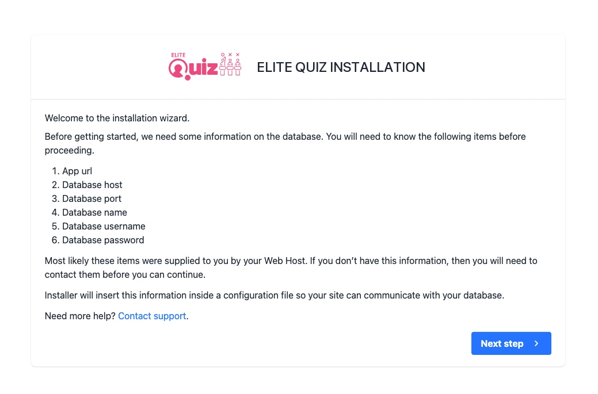
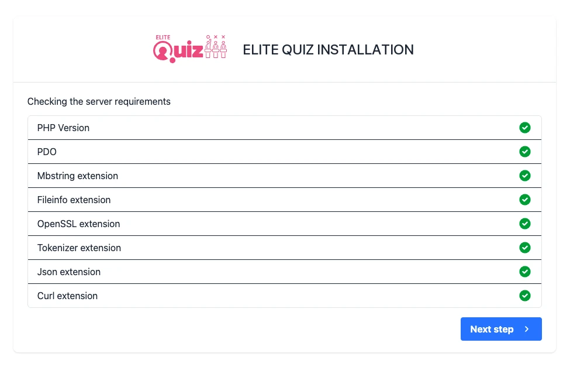
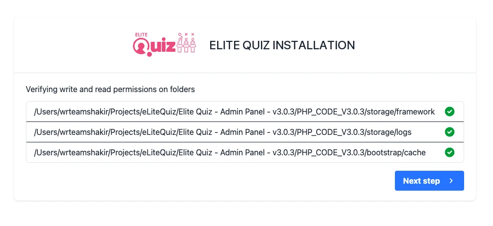
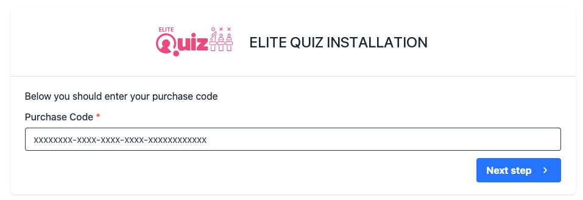
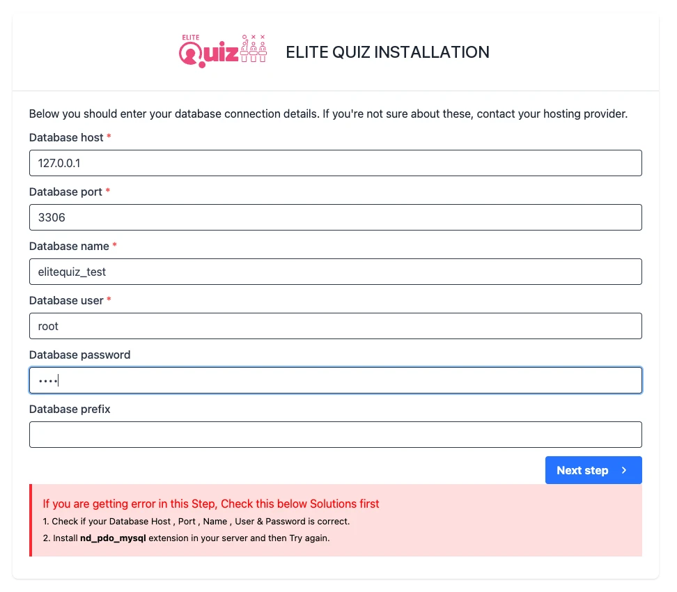
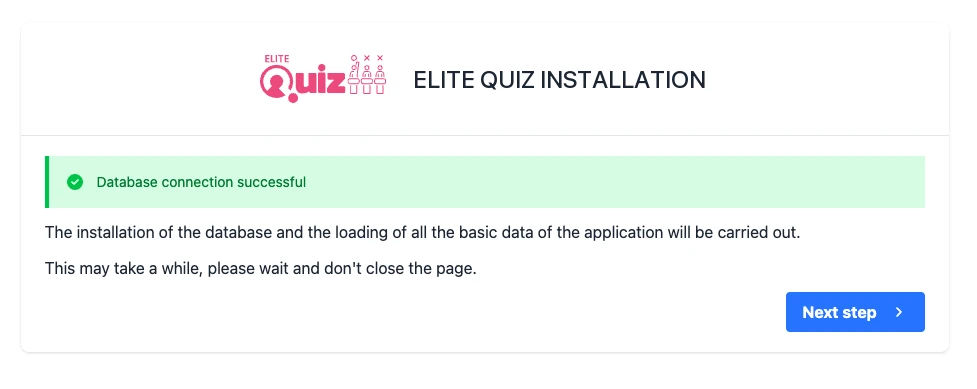
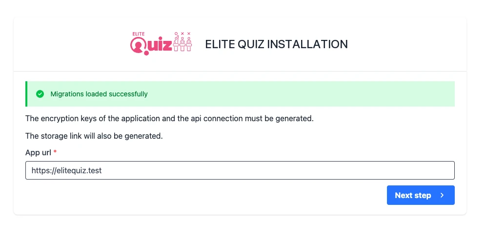
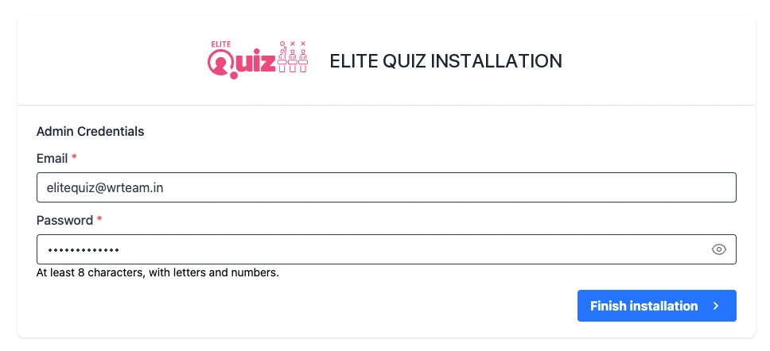
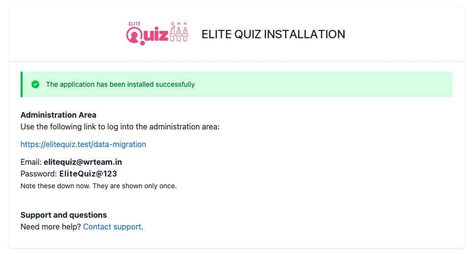

# Installation Steps

Open your Admin Panel domain in the browser (for example `https://admin.your-domain.com`). The installation wizard starts automatically and guides you through the steps below.

## 1. Installation Screen

Keep your database details ready (host, port, name, username and password) and click **Next step**.

## 2. Server Requirements & Extensions

If PHP version is lower than the requirement (PHP 8.2+ / PHP 8.3+ for v3.0.0+) or any extension is not installed, it will be highlighted in Red. Make sure that your server meets all requirements.

**Important Note:** The **`exif`** extension and **`nd_pdo_mysql`** extension are required.

## 3. Permission Screen

Make sure these folders have read & write permissions. If not, then assign these folders read & write permissions.

## 4. Purchase Code Validation

Here you'll have to insert the purchase code obtained from CodeCanyon to authenticate your purchase and authorize your server to access the services.

To find your Purchase code you can visit this link: [Where is My Purchase code?](https://help.market.envato.com/hc/en-us/articles/202822600-Where-Is-My-Purchase-Code-)

## 5. Database Configuration Screen

Enter the database host, port, name, user and password you created on your server. **Database prefix** is optional; leave it empty unless you need one.

If you get an error on this step:

1. Check that the database host, port, name, user and password are correct.
2. Make sure the **`nd_pdo_mysql`** extension is installed on your server, then try again.

## 6. Database Connection Status

Once the connection succeeds, click **Next step** to create the database tables and load the basic data.

:::caution
This may take a while. Wait for it to finish and don't close or refresh the page.
:::

## 7. App URL

Enter your Admin Panel URL in **App url**, including `https://` and without a trailing slash (for example `https://admin.your-domain.com`).

The installer then generates the application's encryption keys and API connection keys, and creates the storage link.

## 8. Admin Credentials

Set the **Email** and **Password** for your Super Admin account. You will use them to log in to the Admin Panel.

- The password must be at least 8 characters and contain both letters and numbers.
- Choose a strong password. Don't reuse a password from another account.

Click **Finish installation**.

## 9. Final Installation Screen

If everything is configured successfully, your Admin Panel has been installed. Use the link shown under **Administration Area** to log in as Super Admin with the email and password you set in the previous step.

:::warning Save your credentials
The email and password are shown on this screen **only once**. Note them down somewhere safe before you leave the page.
:::

