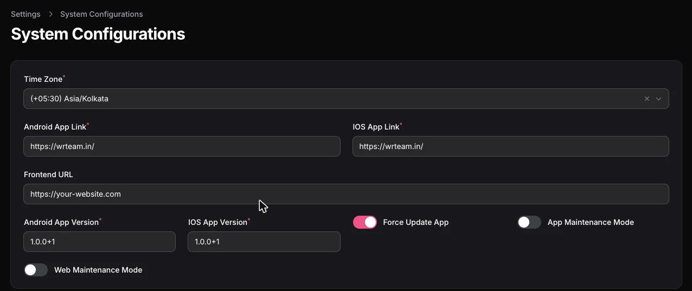
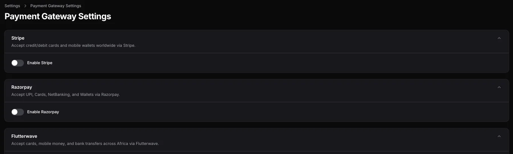
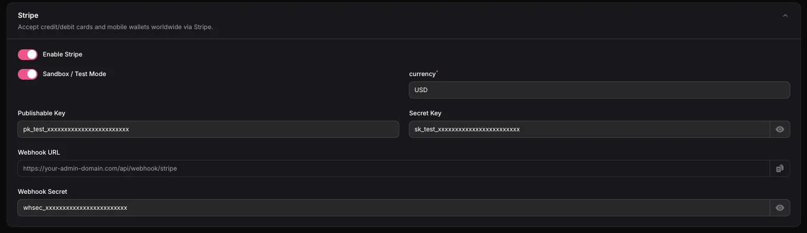
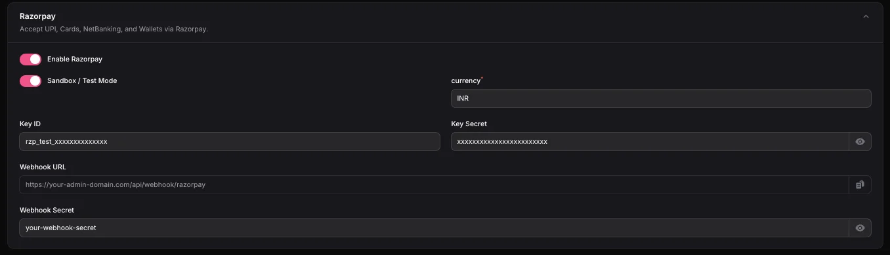
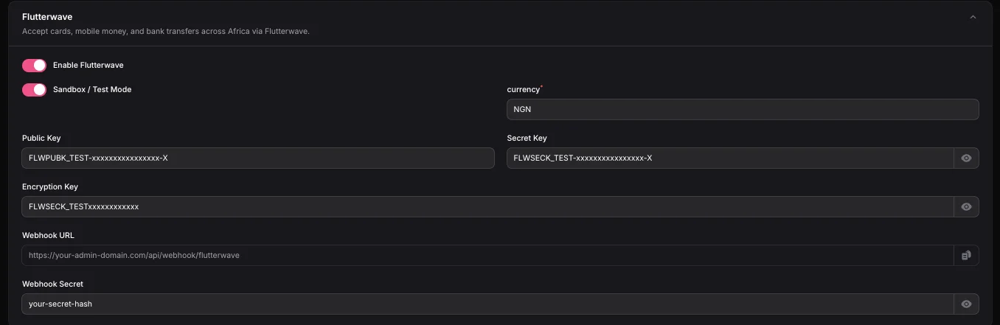

# Payment Gateway Configuration (Web)

Starting with **version 3.0.3**, users can buy coins on the **website** with an online payment gateway. Elite Quiz supports three gateways:

| Gateway         | Best for                                         | Default currency |
| --------------- | ------------------------------------------------ | ---------------- |
| **Stripe**      | Cards and mobile wallets worldwide               | `USD`            |
| **Razorpay**    | UPI, cards, NetBanking and wallets in India      | `INR`            |
| **Flutterwave** | Cards, mobile money and bank transfers in Africa | `NGN`            |

:::info Web only
Payment gateways are used **only by the website**. The Android and iOS apps sell coins through Google Play and App Store **In-App Purchases** instead. To set those up, see [In-App Purchase Configuration](./in-app-purchase-config.md) and [Configure In-App Purchases](../mobile/in-app-purchases.md).
:::

:::note Prerequisites

- Your Admin Panel is live on a public **HTTPS** domain (the gateway must be able to reach it to send webhooks).
- Your website is deployed and you know its URL (see [Deploy the Website](../web/deploy.md)).
- An account with the gateway you want to use: [Stripe](https://dashboard.stripe.com/register), [Razorpay](https://dashboard.razorpay.com/signup) or [Flutterwave](https://app.flutterwave.com/register).
  :::

## How a Web Payment Works

```
┌──────────┐  1. Buy coins   ┌──────────────┐  2. Create checkout  ┌──────────────┐
│ Website  │ ──────────────► │ Admin Panel  │ ───────────────────► │   Gateway    │
│ (user)   │                 │   (API)      │                      │ (Stripe /    │
└──────────┘                 └──────────────┘                      │  Razorpay /  │
     ▲                              ▲                              │ Flutterwave) │
     │                              │ 4. Webhook: payment result   └──────────────┘
     │                              └────────────────────────────────────┤
     │  5. Redirect back to <Frontend URL>/profile/coins-store           │
     └───────────────────────────────────────────────────────────────────┘
                         3. User pays on the gateway's checkout page
```

1. The user picks a coin package on the website.
2. The Admin Panel creates a checkout with the active gateway.
3. The user pays on the gateway's secure checkout page.
4. The gateway sends a **webhook** to the Admin Panel. Coins are added to the user's account **only after this webhook confirms the payment**.
5. The gateway redirects the user back to your website's coin store, using the **Frontend URL**.

Follow the steps below in order.

## Step 1: Set the Frontend URL

The gateway needs to know where to send users after they pay or cancel. Elite Quiz builds that return address from the **Frontend URL** setting, so set it **before** you configure any gateway.

1. Go to **Admin Panel > General Management > Settings > System Configurations**.
2. Enter your website's address in **Frontend URL**, for example `https://your-website.com`.
   - Use the full address with `https://`.
   - Do not add a trailing slash (`/`) or any path.
3. Click **Save Changes**.



After payment, users are sent to:

- Success: `https://your-website.com/profile/coins-store?status=success&route=coin-purchase&package_id=…`
- Cancel: `https://your-website.com/profile/coins-store?status=cancel&route=coin-purchase&package_id=…`

:::warning Set this first
If **Frontend URL** is empty, users will not return to your website after paying. They land on a basic page on the Admin Panel domain instead. If you change your website's domain later, update this field too.
:::

## Step 2: Open Payment Gateway Settings

Go to **Admin Panel > General Management > Settings > Payment Gateway Settings**.



The page has one section for each gateway. Each section has:

| Field                   | What it does                                                                                                   |
| ----------------------- | -------------------------------------------------------------------------------------------------------------- |
| **Enable**              | Turns the gateway on for the website.                                                                          |
| **Sandbox / Test Mode** | On: use the gateway's test environment (no real money). Off: live payments. Must match the keys you paste in.  |
| **Currency**            | The 3-letter ISO currency code charged to users (e.g. `USD`, `INR`, `NGN`). Must be supported by your account. |
| **API keys**            | The keys from your gateway dashboard. They differ per gateway (see below).                                     |
| **Webhook URL**         | Read-only. Click the copy icon and paste it into the gateway dashboard.                                        |
| **Webhook Secret**      | The signing secret that proves a webhook really came from the gateway.                                         |

:::caution Only one gateway at a time
Only **one** gateway can be active. Turning one on automatically turns the others off.
:::

Now set up the gateway you want to use.

## Step 3a: Stripe



### Get the API keys

1. Sign in to the [Stripe Dashboard](https://dashboard.stripe.com).
2. Use the **Test mode** switch to choose test or live keys. It must match the **Sandbox / Test Mode** toggle in the Admin Panel.
3. Go to **Developers > API keys**.
4. Copy the **Publishable key** (`pk_test_…` / `pk_live_…`) into **Publishable Key**.
5. Reveal and copy the **Secret key** (`sk_test_…` / `sk_live_…`) into **Secret Key**.

### Add the webhook

1. In the Admin Panel, copy the **Webhook URL** (`https://your-admin-domain.com/api/webhook/stripe`).
2. In Stripe, go to **Developers > Webhooks** and click **Add endpoint** (or **Add destination**).
3. Paste the Webhook URL as the **Endpoint URL**.
4. Select these events:
   - `checkout.session.completed`
   - `checkout.session.async_payment_succeeded`
   - `checkout.session.async_payment_failed`
   - `checkout.session.expired`
   - `payment_intent.succeeded`
5. Save the endpoint, then click **Reveal** under **Signing secret** and copy it (`whsec_…`).
6. Paste it into **Webhook Secret** in the Admin Panel.

### Finish

Set the **Currency** (e.g. `USD`), turn on **Enable Stripe**, and click **Save Changes**.

## Step 3b: Razorpay



### Get the API keys

1. Sign in to the [Razorpay Dashboard](https://dashboard.razorpay.com).
2. Pick **Test Mode** or **Live Mode** from the mode switch. It must match the **Sandbox / Test Mode** toggle in the Admin Panel.
3. Go to **Account & Settings > API Keys** and click **Generate Key**.
4. Copy the **Key ID** (`rzp_test_…` / `rzp_live_…`) into **Key ID**.
5. Copy the **Key Secret** into **Key Secret**. Razorpay shows it only once, so keep a copy somewhere safe.

### Add the webhook

1. In the Admin Panel, copy the **Webhook URL** (`https://your-admin-domain.com/api/webhook/razorpay`).
2. In Razorpay, go to **Account & Settings > Webhooks** and click **Add New Webhook**.
3. Paste the Webhook URL.
4. Enter a **Secret** of your choice (a long random string) and note it down.
5. Select these active events:
   - `payment.captured`
   - `payment.failed`
   - `order.paid`
   - `payment_link.paid`
   - `payment_link.cancelled`
   - `payment_link.expired`
6. Click **Create Webhook**.
7. Paste the same secret into **Webhook Secret** in the Admin Panel.

### Finish

Set the **Currency** (e.g. `INR`), turn on **Enable Razorpay**, and click **Save Changes**.

## Step 3c: Flutterwave



### Get the API keys

1. Sign in to the [Flutterwave Dashboard](https://app.flutterwave.com).
2. Switch between **Test mode** and **Live mode**. It must match the **Sandbox / Test Mode** toggle in the Admin Panel.
3. Go to **Settings > API Keys**.
4. Copy the **Public Key** (`FLWPUBK…`) into **Public Key**.
5. Copy the **Secret Key** (`FLWSECK…`) into **Secret Key**.
6. Copy the **Encryption Key** into **Encryption Key**.

### Add the webhook

1. In the Admin Panel, copy the **Webhook URL** (`https://your-admin-domain.com/api/webhook/flutterwave`).
2. In Flutterwave, go to **Settings > Webhooks**.
3. Paste the Webhook URL into **URL**.
4. Enter a **Secret hash** of your choice (a long random string).
5. Enable the option to receive webhooks for successful and failed charges, then click **Save**.
6. Paste the same secret hash into **Webhook Secret** in the Admin Panel.

### Finish

Set the **Currency** (e.g. `NGN`), turn on **Enable Flutterwave**, and click **Save Changes**.

## Step 4: Create Web Coin Packages

Only packages marked for the web, with a price, can be bought through a payment gateway.

1. Go to **Admin Panel > General Management > Settings > Coin Package Settings**.
2. Create or edit a package and set **Package Type** to:
   - **Web**: sold on the website only.
   - **Both**: sold on the website and in the apps.
   - **In-App** packages are sold only in the apps and cannot be bought through a gateway.
3. Enter the **Price**. It is charged in the **Currency** of the active gateway, so set prices that make sense for that currency.
4. Save the package.

:::tip
If you switch to a gateway with a different currency, review your web package prices. The numbers are not converted automatically.
:::

## Step 5: Test a Payment

1. Keep **Sandbox / Test Mode** on and use your gateway's test keys.
2. Open your website, sign in, and go to the coin store.
3. Buy a web coin package using a test card from your gateway:
   - [Stripe test cards](https://docs.stripe.com/testing)
   - [Razorpay test cards](https://razorpay.com/docs/payments/payments/test-card-details/)
   - [Flutterwave test cards](https://developer.flutterwave.com/docs/test-cards)
4. Check that you are sent back to your website's coin store and that the coins appear in your balance.
5. In the gateway dashboard, open the webhook delivery log and confirm the event was delivered with a `200` response.

When everything works, switch to live mode:

1. Activate your account for live payments in the gateway dashboard.
2. Replace the test keys with **live** keys.
3. Add the webhook again in **live** mode (test and live webhooks are separate in Stripe and Razorpay) and update **Webhook Secret**.
4. Turn **Sandbox / Test Mode** off and click **Save Changes**.

## Troubleshooting

<details>
<summary><strong>The user paid, but no coins were added</strong></summary>

Coins are added only when the webhook arrives and passes verification.

- Check that the webhook URL in the gateway dashboard exactly matches the **Webhook URL** shown in the Admin Panel.
- Check that **Webhook Secret** matches the secret in the gateway dashboard. Stripe's signing secret changes when you create a new endpoint.
- Make sure the required events are selected (see each gateway's section above).
- Make sure your Admin Panel is reachable over public HTTPS and not blocked by a firewall or maintenance mode.
- Check the webhook delivery log in the gateway dashboard for errors.

</details>

<details>
<summary><strong>After paying, the user lands on the wrong page</strong></summary>

Check **Frontend URL** in **System Configurations**. It must be your website's address with `https://` and no trailing slash. See [Step 1](#step-1-set-the-frontend-url).

</details>

<details>
<summary><strong>A coin package cannot be bought on the website</strong></summary>

Make sure one gateway is enabled and that the package has **Package Type** set to **Web** or **Both** with a **Price** above zero. See [Step 4](#step-4-create-web-coin-packages).

</details>

<details>
<summary><strong>Checkout fails with a currency or authentication error</strong></summary>

- The **Currency** must be supported by your gateway account.
- The keys must match the mode: test keys with **Sandbox / Test Mode** on, live keys with it off.
- Copy keys again without leading or trailing spaces.

</details>
