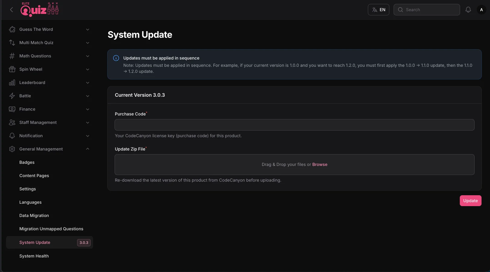

This guide updates an **existing Admin Panel running v3.0.2.1** to **v3.0.3** using the built-in **System Update** page.

:::info Who this guide is for
- **Use this guide** if your Admin Panel is already installed and running **v3.0.2.1**.
- **Fresh installation?** Don't use this guide. Follow [Installation Steps](./installation.md) with the full v3.0.3 code instead.
- **Still on v2.x (CodeIgniter)?** Don't use this guide. Follow [Legacy Data Migration](./legacy-data-migration.md).
- This guide covers the **Admin Panel only**. The Mobile App and Website are not part of this update.
:::

:::tip Quick path
On v3.0.2.1? Upload these two files, in this order, from **General Management → System Update**:

1. `3.0.2.1-to-3.0.2.2.zip`
2. `3.0.2.2-to-3.0.3.zip`
:::

## Why two updates?

v3.0.3 is one release, but it is installed in **two steps** for a safe update:

| Step | Package | What it does |
|------|---------|--------------|
| 1 | `3.0.2.1-to-3.0.2.2.zip` | A small update that upgrades the **System Update tool itself**. Nothing else in your panel changes. |
| 2 | `3.0.2.2-to-3.0.3.zip` | The actual v3.0.3 update (all new features and fixes), installed by the improved System Update tool from step 1. |

The improved System Update tool from step 1:

- **Finishes the update safely:** it first replaces the files, then reloads the page and finishes the update (database changes and permissions) on the new code. The v3.0.2.1 tool tries to do everything in one go, which can stop halfway through a large update like v3.0.3.
- **Checks the package before changing anything:** it refuses an update if a folder isn't writable, and only accepts official, signed update packages.

:::warning Don't skip step 1
Updates must be installed in sequence. The System Update page refuses `3.0.2.2-to-3.0.3.zip` until your panel is on v3.0.2.2.
:::

## Before You Start

1. **Back up your Admin Panel files and database.** Downgrades are not supported, so a backup is the only way back if something goes wrong.
2. **Check your current version.** Log in as the **Super Admin** and open **General Management → System Update**. The version is shown next to the menu item and on the page. It must be **3.0.2.1**.

   

   *The System Update page. This example is already on 3.0.3; before you start, yours should show 3.0.2.1.*
3. **Keep your purchase code ready.** It's your CodeCanyon purchase code for Elite Quiz. [Where is my purchase code?](https://help.market.envato.com/hc/en-us/articles/202822600-Where-Is-My-Purchase-Code-)
4. **Get the update files.** Download the latest Elite Quiz Admin Panel package from CodeCanyon and unzip it. Both files are in its `Update Scripts` folder:
   - `3.0.2.1-to-3.0.2.2.zip`
   - `3.0.2.2-to-3.0.3.zip`

   Upload them exactly as they are. Don't unzip, rename or re-zip them.
5. **Check your server's upload limit.** `3.0.2.2-to-3.0.3.zip` is about 27 MB. Make sure PHP's `upload_max_filesize` and `post_max_size` are at least **32M** (in cPanel: **MultiPHP INI Editor**, or ask your hosting provider).

:::tip
Only the **Super Admin** account can see and use the System Update page.
:::

## Step 1: Update to v3.0.2.2

1. Go to **General Management → System Update**.
2. Enter your **Purchase Code**.
3. Under **Update Zip File**, upload `3.0.2.1-to-3.0.2.2.zip`.
4. Click **Update** and wait. Don't close or refresh the page while it's working.
5. You'll see **System successfully updated to version 3.0.2.2.**
6. Refresh the page and confirm the current version now shows **3.0.2.2**.

## Step 2: Update to v3.0.3

1. Stay on **General Management → System Update**.
2. Enter your **Purchase Code** again.
3. Under **Update Zip File**, upload `3.0.2.2-to-3.0.3.zip`.
4. Click **Update** and wait. This package is larger, so it can take a minute or two.
5. The page reloads by itself and finishes the update. You'll see **System successfully updated to version 3.0.3.**
6. Confirm the current version now shows **3.0.3**.

:::note If the page shows an error after "Update files for version 3.0.3 are installed"
The files are already in place and only the last part is left. **Reload the System Update page**: it finishes the update automatically. Don't upload the package again unless the message asks you to.
:::

## After Updating

- Log out and log back in, then hard-refresh your browser (**Ctrl + Shift + R**, or **Cmd + Shift + R** on Mac).
- Open a few pages you use often (dashboard, categories, questions, settings) and check they load normally.
- See what's new in the [App](../changelog/app.md) and [Web](../changelog/web.md) changelogs for v3.0.3.

## Troubleshooting

| Message | What it means | What to do |
|---------|---------------|------------|
| **Version mismatch. Your current version is …  Please update in sequence.** | The package doesn't match your current version. | Upload the package that starts with your current version: `3.0.2.1-to-3.0.2.2.zip` first, then `3.0.2.2-to-3.0.3.zip`. |
| **System is already updated to version … No action needed.** | That package is already installed. | Move on to the next step, or you're done if it says 3.0.3. |
| **Invalid update package …** | The zip was changed, renamed, re-zipped or isn't an official package. | Download the package again from CodeCanyon and upload the zip from `Update Scripts` without unzipping it. |
| **Update stopped before changing any file: … is not writable by the web server.** | A folder or file can't be written. Nothing was changed. | Give the web server write permission on your Admin Panel folder (ask your hosting provider if unsure), then upload the same package again. |
| **Update stopped while writing …** | The server ran out of space or a permission changed mid-update. | Free up disk space or fix the permissions, then upload the same package again. |
| **The update files are installed, but finishing the update failed …** | The files are in place, but the database step hit an error. | Reload the System Update page to try again. If it keeps failing, contact [support](../support.md) with the full message. |
| **A previous update is not finished yet …** | An earlier update still needs its last step. | Reload the System Update page to finish it, then upload the next package. |
| Purchase code is rejected as already in use | A purchase code works on one installation at a time. | Reset it at [wrteam.in/reset-purchase-code](https://www.wrteam.in/reset-purchase-code) using your CodeCanyon username and purchase code. |
| Upload fails or the file is too large | PHP's upload limit is lower than the package size. | Raise `upload_max_filesize` and `post_max_size` to at least 32M (see [Before You Start](#before-you-start)). |

If anything goes wrong that you can't fix, restore the backup you took before starting and contact [support](../support.md).
